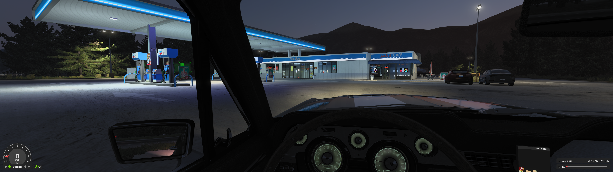
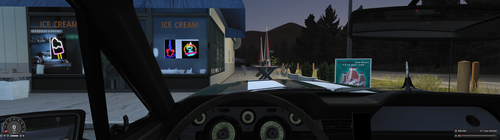
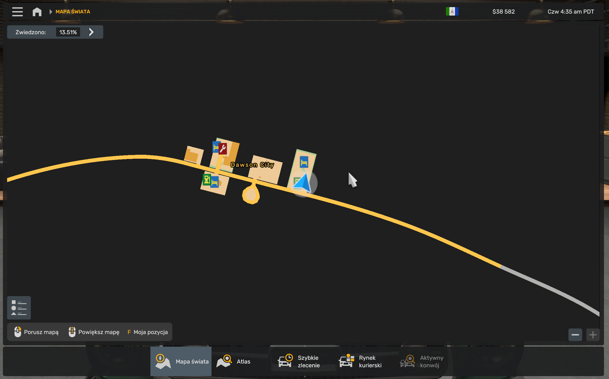

# Gas-station car-rest research

**Status:** Bounded prototype; the user-reported A interaction is now attributed through the game log, while fatigue/reload and full physical validation remain open. **Evidence date:** 2026-10-19 (Europe/Warsaw). This report concerns one explicitly selected Dawson City station, inspected in WCE and generated against the winning Alaska source in the supplied combined stack. It does not claim map-wide coverage.

**Later user feedback — 2026-10-19 evening:** the exact successful screenshot is linked to `painted_bays` through gameplay mounts and small-vehicle trigger events. An active Workshop visual model replaces the base model and has no corresponding car-bank line cluster. This qualifies the original source-model visual assumptions and the offline-only status recorded below; it does not change historical artifacts. See [dated evidence, corrected A/B metadata and next geometry limits](GAS_STATION_CAR_REST_FEEDBACK_2026_10_19.md).

## User direction and boundary

The requested investigation covers both painted passenger-car bays and stations with no painted car bays, including the reported Dawson City case. The prototype is a separate optional `station_parking` processor. It requires one explicit station identifier and an explicit method (`painted_bays` or `unmarked_geometry`). It does not use the existing 1,000-unit rest policy, proximity or density selection; it does not modify the existing rest processor, reuse shared truck/bus actions, or clone truck geometry. The experiment does not launch ATS, change a profile, install a mod, or alter a live save.

## Evidence and exact source scope

**Observed locally — static source inspection (2026-10-19):** The inspected workspace baseline was commit `445ef581886538465564a24be0b1199164e43272`; this report and prototype are on the isolated `codex/gas-station-car-rest-research` branch. The selected placement is Western Canada Expansion v1.7.3, in sector `map/usa/sec-0029-0045.base`, prefab UID `0x5ca1fea582800001` (`prefab.us_gas_08`), associated with ATS 1.61.3.18. The original game definition is `def/world/prefab.sii` → `prefab.us_gas_08` → `prefab/gas/nm_truckstop1_chemron.ppd`, with model `prefab/gas/nm_truckstop1_chemron.pmd`. The fuel-only r2 baseline retargets it to `def/world/prefab.rtg253fcfb3.sii` and `prefab/rtfix/rtg253fcfb3.ppd`. The original source-sector SHA-256 recorded by inventory is `c5a4bf4c29409d9c2efef813bb65236c2d9a03576d1bbab59f2e3289bbb27ccb`.

The exact placement and candidate selection come from `local_outputs/work/2026-10-19_01-26-31/station-inventory/dawson-city-station-inventory.json` in the main checkout. The original inventory records two GAS locators and two fuel services. The pinned fuel-only baseline preserves those and adds two matching car locators/services; its effective descriptor therefore has four GAS slots and four corresponding services. The selected station is the east-side gas station visible by map position in the supplied screenshot; the same sector also contains a Mack truck dealer, other prefab placements, and a nearby garage FuelPump. Selection therefore uses the source prefab UID and service/spawn relationship, not branding or a broad city query. The source archive and effective sector/base-fix hashes are pinned in both authored inputs at [`docs/examples/station-parking-dawson-city-painted-bays.json`](../examples/station-parking-dawson-city-painted-bays.json) and [`docs/examples/station-parking-dawson-city-unmarked-geometry.json`](../examples/station-parking-dawson-city-unmarked-geometry.json).

**Observed locally — source versus combined-stack priority (2026-10-19):** this WCE inventory and the WCE-pinned examples below are valid standalone source diagnostics. A later full-stack check found that Alaska Expansion has a higher-priority override for Dawson's same `map/usa/sec-0029-0045.base` virtual path. Therefore the WCE-only outputs from the 01:46, 01:49, and 01:51 runs do not describe the sector that wins when the combined Alaska/WCE stack is loaded with a fix placed directly above WCE. The WCE policies remain useful for reproducing bounded WCE source analysis, but they must not be treated as the combined-stack fix or installed as if they override Alaska. Both final combined-stack alternatives have now been generated against the winning Alaska Expansion 1.2.3 source and its own pinned fuel-only r2 baseline. The [Alaska painted policy](../examples/station-parking-dawson-city-alaska-painted-bays.json) and [Alaska geometry policy](../examples/station-parking-dawson-city-alaska-unmarked-geometry.json) identify the same placement through effective alias `rtg822b7379`. Final archive fingerprints and source priority are in the [handoff](GAS_STATION_CAR_REST_POC_HANDOFF.md). This report does not claim broad WCE or Alaska coverage; no game launch or runtime validation has occurred.

**Unknown:** the source sector neighbor inventory lists 15 nearby SignBoard items within the UI-map polygon/edge query. Their collision geometry was not parsed. This leaves a local collision/overlap uncertainty; it does not change the station identity or prove that any signboard intersects a candidate.

## User screenshots

The screenshots establish the reported location context, not runtime rest behavior.

*Dawson City station/cafe from the vehicle, screenshot timestamp 2026-10-19 00:42:22.*

*Cafe-side seating and the adjacent lot, screenshot timestamp 2026-10-19 00:42:42.*

*World-map view centered on Dawson City, screenshot timestamp 2026-10-19 00:43:05.*

## Painted-bay representation

**Observed locally — installed model and descriptor inspection:** The evidence is recorded in `local_outputs/work/2026-10-19_01-26-16/marked-research/dawson-car-bay-evidence.md`. ATS 1.61.3.18 `base.scs` member `prefab/gas/nm_truckstop1_chemron.pmg` has SHA-256 `eaf63893a37537bc2acb5e0d961115ea1534c422b6e12c56c94dd7fee89ce491`. ConverterPIX converted only that named model to text PIM/PIT/PIP. The resulting PIM SHA-256 is `7a9ea5a438a75ecab933f71ec78574ef9ecac3db3f22124d6808e6b15997af74`.

In PIM piece 5, material alias `mat_0005_lines1` resolves to `/material/road/lines1` with effect `eut2.dif.spec.a.decal.over`. Triangles 226–233 form four coplanar parallel marking strips, each about 0.19 m wide and 6.40 m long. Their centers are spaced approximately 2.858 m apart, corresponding to three nominal 2.86 × 6.40 m parking spaces. The strip envelope is X 16.827–25.590 m, Z −21.144–−14.740 m, at Y approximately 0.14610 m in prefab coordinates. The prototype selects these four separators, constructs three interior bay polygons, and insets their envelope by 0.25 m at the ends and outer sides. This geometry is derived from the lines mesh, not hand-entered candidate coordinates.

The matching regular PPD has no car action, while the `_rt` PPD has a native `parking_car` group whose bounds overlap the painted strips. This is a positive control that the same visible model can have separate car eligibility. **The `_rt` polygon is not copied or used as a fallback.** The prototype adds its own native car-only group to the selected regular station descriptor and preserves original trigger records and descriptor sections.

**Correction to an earlier interpretation:** nine `truck.parked.physics` locators and absence of car locators do not establish that the visible painted bays are absent, nor identify the source of NPC vehicles in the screenshot. The mesh contains an explicit `collpart1` part (piece 0); ConverterPIX's `pic:no` says it emitted no separate PIC file, not that the engine has no collision data.

## Unmarked-station geometry

**Observed locally — static geometry proposal:** The unmarked method uses source UI-map polygons to propose a small rectangular parking footprint and an adjacent approach strip. It then samples the selected prefab's render mesh on a 0.5 m grid, compares against nonvertical model triangles, excludes candidate points where model triangles rise 0.2–1.9 m above sampled ground, and rejects overlaps with modeled obstacles, fuel-pump clearance areas, parked-truck locator envelopes, or source road polygons. The unmarked method uses a 2.5 m building setback, a 0.5 m obstacle margin, 6 m pump clearance, a 3.5 m map-road corridor clearance, and a 4 m approach strip. The separate painted method applies the 0.25 m inward margin to its measured bank envelope. The selected Dawson rectangle is approximately 3 × 6 m; the approach is approximately 3 × 4 m. Its reported candidate has 147 mesh surface samples, no missing samples, and no modeled obstacle/parked-locator conflicts. Candidate geometry remains a static proposal: render-mesh checks do not resolve physics collision, external unparsed sector objects, vehicle maneuverability, or actual access from the road.

The inventory found a large existing truck `hud_parking` polygon in the broader placement descriptor, well away from the selected station's proposed car footprint. It remains unchanged. The writer appends a fresh independent `parking_car` group to the explicit station's effective descriptor, retaining original bytes and all source nodes/services in the selected sector. The new gas-station alias has no original context tags: the context planner proves that it remains unclassified rather than inventing tags. The original WCE fuel baseline's 11 private aliases were audited against the raw effective WCE source; the final Alaska baseline's two private aliases were independently audited against the winning source in the complete supplied stack. Both sets are unclassified. No context additions are required here. The historical 14 Company-parent gap concerned WCE r3 rest aliases, not evidence of 14 missing classifications in this fuel-only baseline.

## Prototype, outputs, and deterministic selection

The prototype consists of [`station_mesh.py`](../../src/ats_road_trip/station_mesh.py) (strict bounded ConverterPIX PIM text reader and surface sampling), [`station_geometry.py`](../../src/ats_road_trip/station_geometry.py) (source UI geometry and candidate exclusion), [`painted_parking.py`](../../src/ats_road_trip/painted_parking.py) (parallel separator detector), [`station_trigger.py`](../../src/ats_road_trip/station_trigger.py) (native v25 `parking_car` polygon writer), [`station_parking.py`](../../src/ats_road_trip/station_parking.py) (explicit config and source-pinned plan), [`station_run.py`](../../src/ats_road_trip/station_run.py), and the separate CLI entry point. Each method is explicit in its input JSON. Geometry-only configurations may set the paint-material list empty; an asphalt-only authored fixture proves the method can run without painted mesh or parked-vehicle locators. Where paint or parked locators exist, they remain reviewed material classifications and conservative obstacle evidence rather than sources of proposal coordinates. The source archive, fix archive, sector, descriptor, model and converted mesh hashes are pinned to reject source drift. Only the named station placement is retargeted; unrelated sector nodes/services and original descriptor trigger data are asserted unchanged.

The observed static probe at `local_outputs/work/2026-10-19_01-39-16/station-probe/` reported one painted-bay bank with three candidate spaces and nine unmarked geometry candidates before deterministic selection. Each authored method config selects one candidate for one station. These counts describe this bounded Dawson probe only. They do not prove absence or coverage for other stations or maps. The committed-size inputs in `docs/examples/` are source-pinned examples, not released mods.

ConverterPIX provenance: source repository commit `3cd4e73a86d0c6bd28e117664c50a36cabeccf38`, LGPL-3.0, Linux executable SHA-256 `fba5a52f763d07d3dc110dea4980fe2c7e656a8c0afa05b6b7a4ab4373dc950d`. It was used as an external conversion tool for the named PMG only; no ConverterPIX code or binary is vendored or adapted into this project. The project reader consumes its text output. The format interpretation is cross-checked against the [official SCS game format documentation](https://modding.scssoft.com/wiki/Documentation/Engine/Formats) and [official prefab locator documentation](https://modding.scssoft.com/wiki/Documentation/Tools/SCS_Blender_Tools/Locators/Prefab_Locators); these references do not document all ConverterPIX PIM details. TruckLib source documentation was also consulted for sector structure; see its existing attribution and notice in the project documentation.

## Current evidence matrix

| Question | Evidence | Status / limit |
| --- | --- | --- |
| Which Dawson gas station is targeted? | Exact source sector, prefab UID, model/descriptor relationship, fuel spawn/service mapping, and screenshot map position | **Observed locally**; explicit placement selected, no city-wide inference |
| Are there painted car-sized bays? | Four line-mesh separators; dimensions and spacing yield three spaces | **Observed locally** static model evidence; markings do not prove collision or gameplay eligibility |
| Does a native car marker fit the painted bays? | Candidate polygons from separator geometry, mesh heights and selected regular descriptor | **Observed locally** structurally generated; not runtime-validated |
| Is there an unmarked parking candidate? | Nine geometry proposals; selected rectangle passes current render mesh/road/pump/locator checks | **Observed locally** proposal only; external sector collision and driving access remain uncertain |
| Does the action appear and restore fatigue correctly? | No game test | **Unknown** |
| Are NPCs or parked vehicles an obstruction in play? | Screenshot and static model locators only | **Unknown**; no locator absence/presence claim predicts NPC origin or runtime occupancy |
| Are all nearby source collisions excluded? | Render model plus source road polygons; SignBoard sector entries not collision-decoded | **Unknown** |
| Are aliases/context classifications retained? | Source-to-baseline and baseline-to-station alias transitions audited; the final Alaska baseline's two aliases and the new station alias have no source tags (the earlier WCE baseline had 11) | **Observed locally** static preservation at this declared stack; runtime offers remain unverified |
| Does this generalize to other stations/maps? | A second placement of the same model passes; a distinct three-row station blocks on additional parts, and a four-row visual component has no GAS locator | **Observed locally** bounded matrix; no map-wide support claim |

## Additional explicit station samples

**Observed locally — 2026-10-19:** the second `us_gas_08` placement, WCE sector `map/usa/sec-0018-0030.base`, UID `0x57320980a1000001`, passes both methods with the same local geometry transformed to different world coordinates. [Painted policy](../examples/station-parking-sample-wce-truckstop-painted-bays.json) and [unmarked policy](../examples/station-parking-sample-wce-truckstop-unmarked-geometry.json) pin that selection independently. This checks placement transformation, not a new prefab family's support.

A different WCE placement in `map/usa/sec-0025-0018.base`, UID `0x53397912de930001`, uses `us_gas_chemron_truck_3rows_roof` and has two GAS locators. It uses the default variant plus five additional parts, so the current planner blocks before proposing output. Direct diagnostics, kept distinct from accepted planning, found no separator bank and no unmarked proposal in the available geometry. This is a variant/geometry limitation, not proof that a car cannot park there.

The nearby `prefab.0400m` four-row car-station component, UID `0x53397aa731130001`, has no GAS locator in its own PPD. Its model cannot yet be associated automatically with a separate trigger-only prefab in this single-prefab planner. Do not label it an invalid station. Composite station association is a concrete next increment. Exact hashes, raw and effective identities, scripts, reports and SVGs are retained in `local_outputs/work/2026-10-19_01-41-42/station-parking-samples/` in the research worktree.

**Limit:** the geometry-only method ignores painted separators, but its successful real samples currently share a model that also has marked bays elsewhere. An accepted positive on a genuinely unmarked, different prefab family has not been established. The separate method and its diagnostic blockers exist; broad generalization is still research.

## Verification and manual handoff

Automated checks cover PIM parsing and bounds, separator detection, terrain-height sampling, candidate exclusions, malformed inputs, source pinning, deterministic output, exact selected-placement changes, preserved source services and preserved original trigger records. The implementation milestone `4aaeea8` passed 324 tests; the completed prototype, including empty-paint geometry inputs and visible diagnostic decisions, passes all **326** tests with `PYTHONPATH=src python3 -m unittest discover -s tests -q`; `git diff --check` is clean. The [separate package handoff](GAS_STATION_CAR_REST_POC_HANDOFF.md) records final fingerprints, reproducible commands and later manual checks. The final SVGs show detected paint strips, numbered candidates, visible rejection causes and a detail inset as well as the full lot. Both were rendered and visually inspected. Static tests do not substitute for a game test.

Manual validation remains necessary before treating either configuration as usable: install only in a disposable test profile after reviewing the generated package, approach and enter the selected bays/rectangle with a passenger car, check marker visibility and the rest prompt, confirm fatigue recovery and reload behavior, and inspect truck/bus/shared actions independently. Check physical clearance and approach access, including nearby signs and actual NPC/parked-vehicle behavior. Do not alter or reset the user's live profile. Results must be recorded as user-reported gameplay evidence; no such validation is claimed here.

## Screenshot integrity

The three PNGs were copied from `local_inputs/gas-station-car-rest/dawson-city/` on 2026-10-19. Source and documentation copies had matching SHA-256 values:

| File | SHA-256 |
| --- | --- |
| `ats_20261019_004222_00.png` | `d2902bb005f71b61efb844ac1ff164ca839dd5b3b72984bcc6e275e345a4994d` |
| `ats_20261019_004242_00.png` | `78810d765ee992ebc3fd21b2c019899e4d461e6fdd36df2f0769cfb9f3a00965` |
| `ats_20261019_004305_00.png` | `09203d765d2f89a9cd098caaf3bda9175398a80abdb605babbfcd5126a1a62c2` |

## References

- [Existing passenger-car rest research](PASSENGER_CAR_REST_RESEARCH.md)
- [Independent car-marker geometry decision](../architecture/decisions/ADR-0017-separate-car-rest-marker-geometry.md)
- [Compatibility processor coverage and limits](COMPATIBILITY_PROCESSORS.md)
- [Painted-bay input example](../examples/station-parking-dawson-city-painted-bays.json)
- [Unmarked-geometry input example](../examples/station-parking-dawson-city-unmarked-geometry.json)
- [Independent station-parking decision](../architecture/decisions/ADR-0018-isolate-source-pinned-station-parking-poc.md)
- [PoC package handoff](GAS_STATION_CAR_REST_POC_HANDOFF.md)
- [Current research task](../tasks/done/TASK-0039-research-gas-station-car-rest.md)
